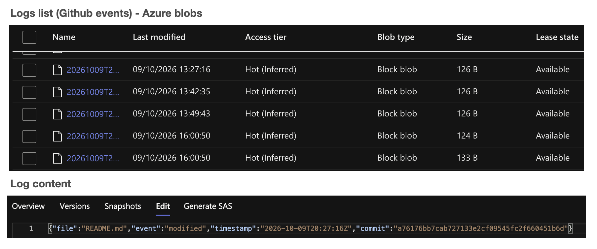

# Event-driven logging into Azure Blob based on a GitHub webhook

# Introduction

Events tracking on GitHub using a webhook and Azure function + Blob storage to process and host the log

In this project, a webhook reads the modfications brought to the current GitHub repository, which contains the Terraform code of this same Azure project.
Each commit & push will call an HTTP-triggered Azure function, which will process the payload released by the webhook.
This HTTP_triggered Azure function will read and process the payload, and create a new Blob in an Azure Blob storage containing the event details recorded in the payload (file added, modified or removed + date).

A screenshot of the application output is available in the Screenshots folder.

# GitHub Events Logging - details

## Screenshot



## Overview

**GitHub Events Logging** is a small serverless application built with Azure Functions and PowerShell. It receives notifications sent by GitHub through a webhook and stores the received event data in Azure Blob Storage.

The project was created to explore the integration between GitHub and Azure while maintaining a record of relevant repository events for later inspection and analysis.

## Architecture

The application follows this general workflow:

1. **GitHub event detection:** When a configured event occurs in the GitHub repository, GitHub sends an HTTP webhook request to the application. Depending on the webhook configuration, monitored events may include pushes, pull request activity, issues, or other repository events. The exact list of subscribed events is defined in the GitHub webhook settings.
2. **Webhook reception:** An Azure Function running PowerShell receives and processes the HTTP request.
3. **Event logging:** The relevant event information is stored in Azure Blob Storage for later inspection.

```text
GitHub Repository
        |
        | Configured webhook events
        | (e.g. push, pull request, issues)
        v
Azure Functions
   (PowerShell)
        |
        | Event logging
        v
Azure Blob Storage
```

## Azure Environment

The application uses the following resources in the existing Azure environment:

- **Resource Group:** `FunctionsRG`
- **Region:** `westeurope`
- **Function App:** `FoundationalFunctions`
- **Application Insights:** `FoundationalFunctions`
- **Storage:** Azure Storage accounts associated with the application

These names and settings reflect the original environment. They may differ in another deployment.

## Application Files

The application folder contains, among other files:

- `run.ps1`: the PowerShell script that processes incoming webhook requests, provided this matches the script name configured for the function.
- `function.json`: the function definition, including its HTTP trigger and binding configuration.

The repository also contains a Terraform snapshot of the existing Azure infrastructure in `snapshot-retry/`, along with additional project documentation at the repository root.

## Configuration and Security

The application relies on configuration settings to access storage and secure the webhook.

The following settings must be reviewed when installing or restoring the application:

- `AzureWebJobsStorageForGitHubLogs`
- `GitHubWebhookSecret`
- `AzureWebJobsStorage`

These settings may contain confidential information. **Secret values must never be committed to GitHub in plain text.**

Secrets should be configured through the Azure Function App settings or an appropriate secret-management mechanism. Any values required for operation must be securely supplied when deploying to a new environment.

The GitHub webhook must use the secret expected by the application. The GitHub-side and Azure-side configurations must remain consistent.

## Prerequisites

Running or restoring the project requires, among other things:

- An Azure account with the necessary permissions.
- An Azure Function App compatible with the programming model used by the application.
- The required PowerShell runtime and function extensions.
- A properly configured Azure Storage account.
- A GitHub repository with a webhook configured to send the desired events.
- The required application settings and secrets, supplied securely.

The exact runtime version and dependencies must be confirmed against the actual Function App configuration.

## Infrastructure as Code

The `snapshot-retry/` directory contains an initial Terraform export of the existing Azure resources.

This snapshot provides a starting point for documenting and potentially managing the infrastructure as code. It does not, by itself, guarantee a complete and functional reconstruction of the environment.

Before attempting a restoration, the following steps are required:

- Review the exported resources and the resources listed as skipped.
- Check sensitive settings and dependencies between resources.
- Confirm that all files and configuration required to deploy the Function App are present.
- Review and validate the Terraform plan before making any infrastructure changes.

A full infrastructure restoration has not yet been validated.

## Project Status

The repository serves as an initial backup of the application code and a snapshot of the existing Azure infrastructure.

Potential next steps include:

- Reviewing the PowerShell code and HTTP trigger definition.
- Documenting the event payloads and the format of the stored logs.
- Confirming that all required deployment files are present.
- Testing restoration in a controlled environment without affecting the existing infrastructure.

## License and Usage

This project is intended for personal or experimental use within the associated Azure environment. Before reusing it elsewhere, review the configuration, permissions, and security requirements.
